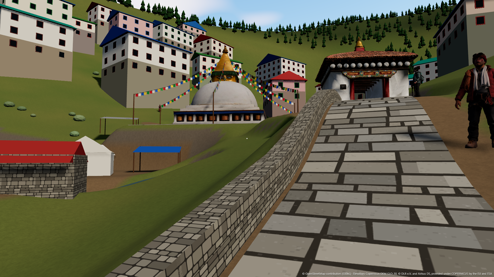
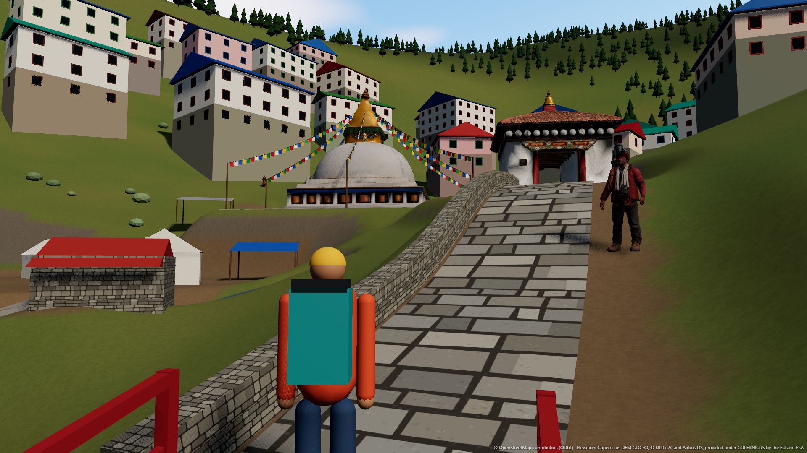
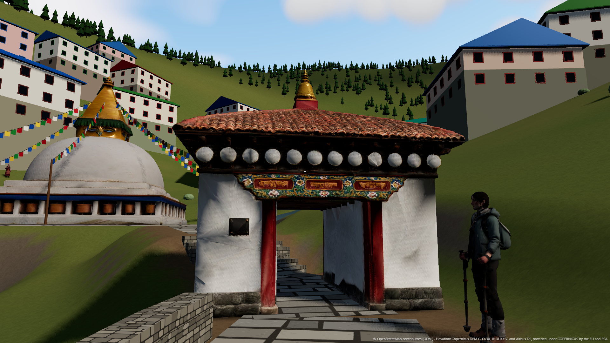
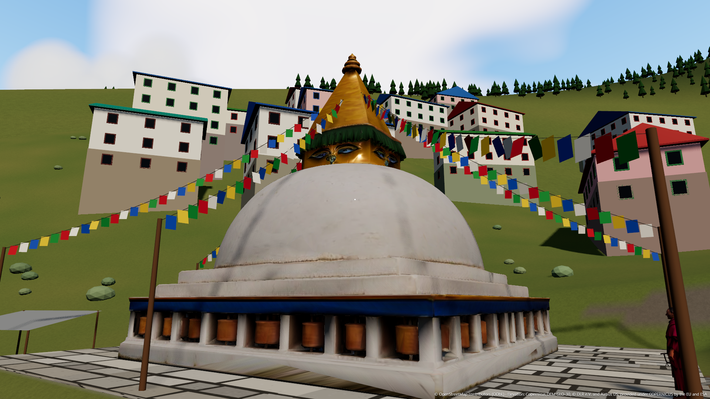
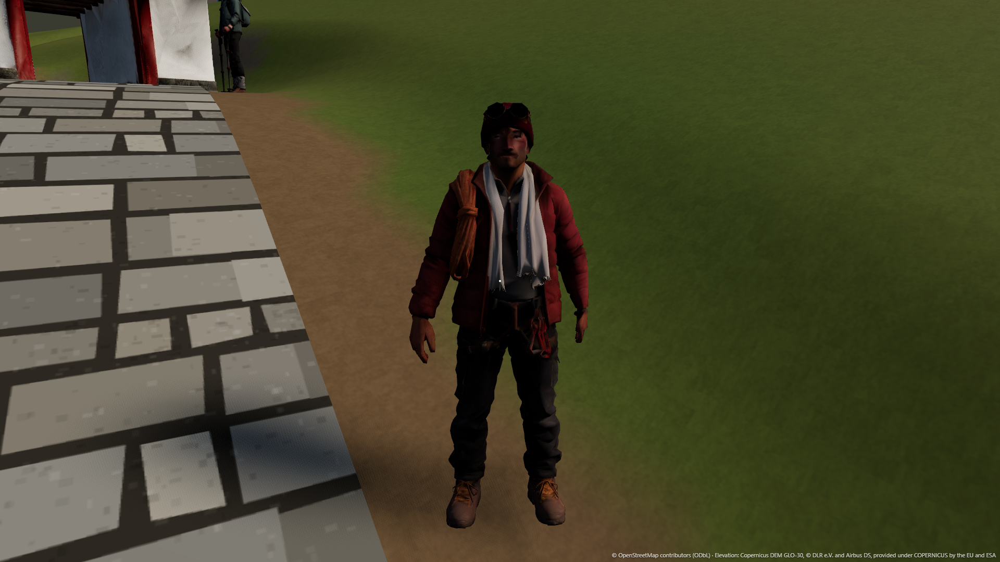
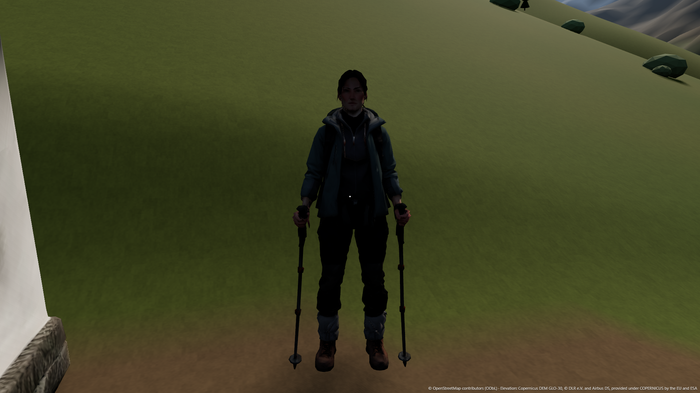
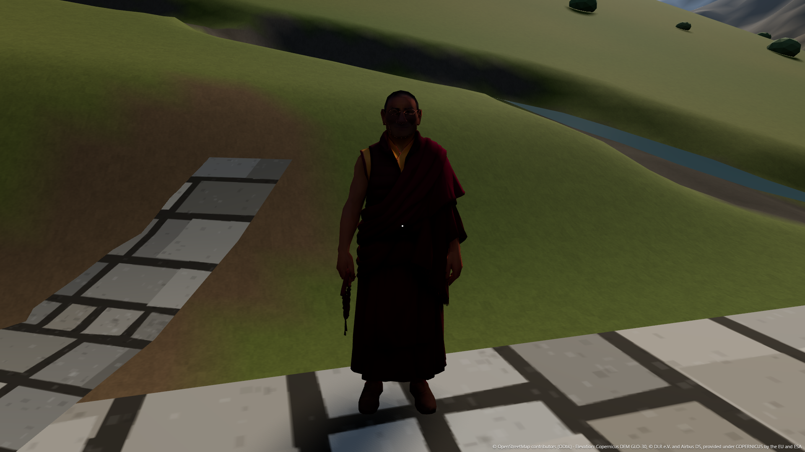
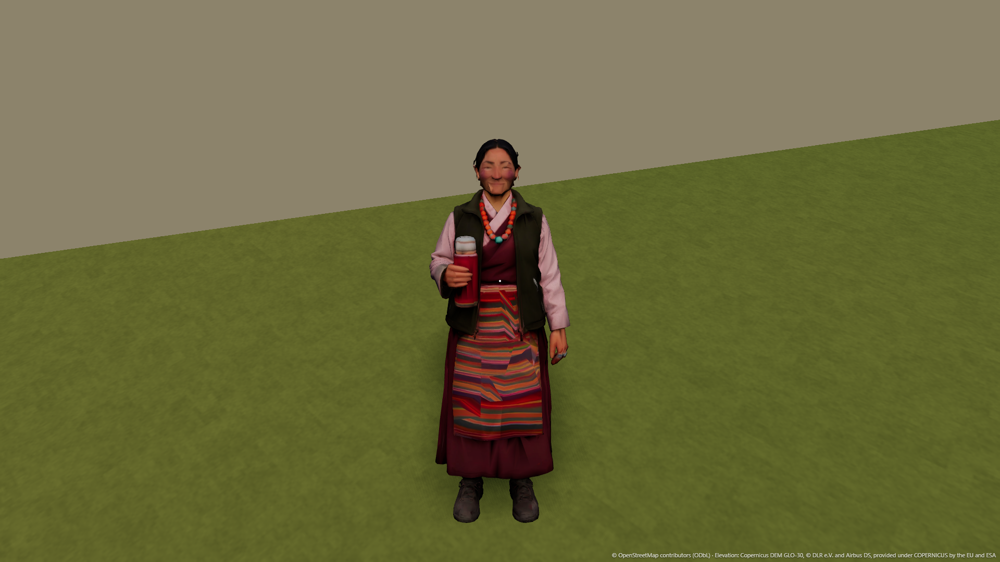
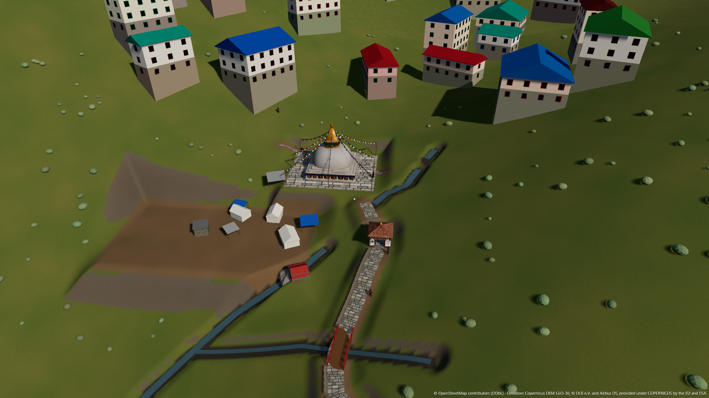

# M2 visual gaps: the entrance with the real models

Screenshots: `docs/screenshots/m2/`, taken with `tools/m2_shots.py` (headless Chromium on the RTX 3050 Ti
through ANGLE D3D11, WebGL2 backend, 1920 x 1080). The camera for every shot is in `shots.json`.

The reference photos and the Higgsfield renders stay local and git-ignored, so the links to them in this
file only open on this machine. The overlay images are in `reference/overlays/` for the same reason.

## What is in the game

| Model | Source | Triangles · file | Where |
| --- | --- | --- | --- |
| Kani gate | gate3.glb (Meshy multi-view) | 38,000 · 2.4 MB | OSM way/344630686, passage north-south, front south. The decoded yellow mark is 0.3 m away |
| Main stupa | stupa2.glb (Hunyuan) | 38,000 · 1.1 MB | OSM way/344630942 on the plaza. The decoded white mark is 0.9 m away. Base 11.0 m; spire shortened so the total height is 11.5 m (was 13.6 m) |
| Guide | char_guide.glb | 8,000 · 0.35 MB | Right verge, 6.5 m up the path from the spawn, facing down |
| Mountaineer | char_mountaineer.glb | 8,000 · 0.29 MB | Right verge, 3 m below the gate |
| Monk | char_monk.glb | 8,000 · 0.24 MB | East edge of the stupa plaza, facing the stupa |
| Lodge owner | char_lodge.glb | 8,000 · 0.28 MB | In front of the lodge nearest the plaza |

How they were made: `tools/assets/reduce.py` welds duplicate vertices, collapses to the target triangle
count, scales to the real size with the base on y = 0, and writes 2K textures. Then
`gltf-transform optimize --compress meshopt --texture-compress webp` compresses them. KTX2 was not possible:
gltf-transform needs the `toktx` binary, which would mean installing KTX-Software on the system, so the
textures are WebP. If a model fails to load, M1's primitive gate and stupa stay in place and the failure is
logged. The characters are static: they breathe and turn towards the player within 6 m, with no rig.

## Shots against the references

| Shot | Game | Reference photo | Higgsfield render |
| --- | --- | --- | --- |
| Spawn, first person |  | [chat_03](../reference/chat/chat_03.webp) | none |
| Spawn, third person |  | [chat_03](../reference/chat/chat_03.webp) | none |
| Alignment overlay (50 %) | [overlay](../reference/overlays/spawn_vs_chat03_50.png), [side by side](../reference/overlays/spawn_vs_chat03_side.png) | chat_03 | none |
| Kani gate |  | [chat_09](../reference/chat/chat_09.webp), [chat_10 marked](../reference/chat/chat_10.webp) | [gate3](../assets-src/fable-export/renders/models/gate3_0.png) |
| Stupa |  | [chat_11](../reference/chat/chat_11.webp) | [stupa2](../assets-src/fable-export/renders/models/stupa2_0.png) |
| Guide |  | none | [sheet](../assets-src/fable-export/renders/characters/1_guide_sheet_small.jpg) |
| Mountaineer |  | none | [sheet](../assets-src/fable-export/renders/characters/5_mountaineer_sheet_small.jpg) |
| Monk |  | none | [sheet](../assets-src/fable-export/renders/characters/4_monk_sheet_small.jpg) |
| Lodge owner |  | none | [sheet](../assets-src/fable-export/renders/characters/3_lodge_owner_sheet_small.jpg) |
| Overview |  | [chat_06 top view](../reference/chat/chat_06.webp) | none |

## Alignment of the spawn view with chat_03

The camera is M1's, unchanged: eye at 1.62 m, looking 6.35 degrees west of north, pitch +4 degrees, 78
degrees horizontal field of view.

The elements sit in the same left-to-right order: tents and open ground on the left, the stupa in the
centre, the gate building on the right, the path in the right foreground. The match is still only fair:

- The stupa fills about twice the width it does in the photo and sits about 15 % of the frame lower. The
  photo was taken further down the trail, or with a narrower lens.
- The photo looks across a deep drop to the town. The game's town starts right behind the stupa.

The next fix is moving the spawn about 10 to 15 m further down the trail, or narrowing the field of view
for this shot. I did not change the camera, because you told me to keep it.

## Top five remaining gaps

1. **The lodges are oversized plain blocks.** They are 4 to 5 storeys, flat-faced, and too close and too
   few. The photo shows dozens of smaller 2 to 4 storey lodges stacked up the slope, with balconies and
   blue, green and red roofs.
2. **The terrain is smooth lawn.** The photo has terraced fields, scrubby shrubs, stone walls and a forest
   that thickens up the ridge. M1's ground is one green and the trees are sparse cones.
3. **The path is too wide and its flagstones too big.** Its retaining wall is a flat-tiled box. In the
   photo the path is a narrower, irregular stone way with a rough dry-stone edge and a grass verge.
4. **Light and sky are flat.** There are no big cumulus clouds and no haze over the ridge, and the
   generated textures are lit flatly. The whitewash on the gate and stupa reads grey in shade and the
   creases in the generated texture show up close.
5. **No crowd and no market life.** The photo has trekkers, porters and the camp below the stupa. The game
   has four static figures who don't animate. The backs of the characters are the generator's guess: the
   mountaineer has a grey daypack and the lodge owner no braid.
